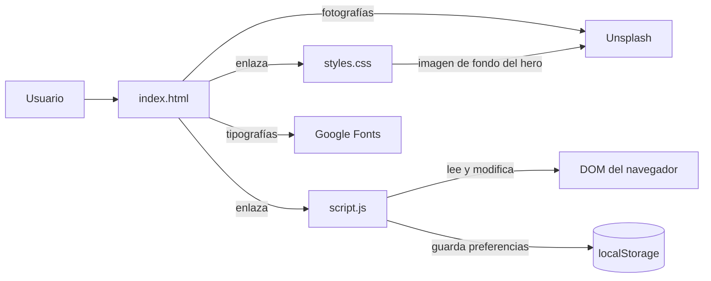
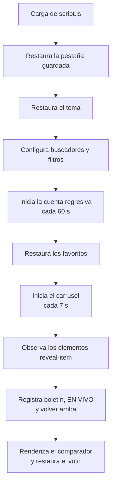
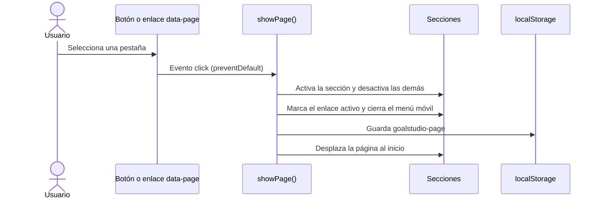

# GOALSTUDIO


<!-- TODO: agregar badge de licencia cuando se defina -->

Sitio web estático y responsivo dedicado al fútbol. Presenta noticias, partidos, clubes, futbolistas y estadísticas en una navegación por pestañas sin recarga de página y sin backend.

Está orientado a usuarios interesados en consultar contenido futbolístico, explorar perfiles y guardar preferencias en su navegador.

## Acerca de la creación del proyecto

GOALSTUDIO fue diseñado e implementado con asistencia de inteligencia artificial, bajo la dirección, revisión y criterio técnico de **Camilo Alejandro Prieto Villarreal**. La IA apoyó la generación de estructura, estilos e interacciones, la corrección de errores y la redacción de esta documentación.

Es un **prototipo demostrativo** creado para aprender y explorar el desarrollo web. Las noticias, fechas, resultados, estadísticas y marcadores son datos de ejemplo escritos en el código: no son oficiales ni están sincronizados con ninguna fuente externa.

> Antes de usar el proyecto con fines públicos o comerciales, revise manualmente la precisión del contenido, la accesibilidad, los derechos de las imágenes y el funcionamiento (ver [Limitaciones conocidas](#limitaciones-conocidas)).

## Tabla de contenidos

- [Características principales](#características-principales)
- [Vista previa](#vista-previa)
- [Arquitectura](#arquitectura)
- [Stack tecnológico](#stack-tecnológico)
- [Estructura del proyecto](#estructura-del-proyecto)
- [Requisitos previos](#requisitos-previos)
- [Instalación y ejecución](#instalación-y-ejecución)
- [Uso](#uso)
- [Datos y fuentes](#datos-y-fuentes)
- [Persistencia local](#persistencia-local)
- [Limitaciones conocidas](#limitaciones-conocidas)
- [Pruebas](#pruebas)
- [Despliegue](#despliegue)
- [Roadmap](#roadmap)
- [Contribución](#contribución)
- [Créditos y licencia](#créditos-y-licencia)
- [Autor](#autor)
- [Información pendiente](#información-pendiente)

## Características principales

- Navegación por pestañas (Inicio, Noticias, Partidos, Clubes, Futbolistas, Estadísticas) sin recarga de página.
- Carrusel de noticias destacadas en Inicio, con flechas y avance automático cada 7 segundos.
- Buscadores en Noticias, Clubes y Futbolistas.
- Filtros de partidos por competición: Champions, Premier, Serie A, LaLiga y Bundesliga.
- Cuenta regresiva de cada partido, actualizada cada minuto.
- Marcadores simulados que se activan con el botón **EN VIVO**.
- Favoritos en noticias, clubes y futbolistas, guardados en el navegador.
- Tema oscuro y tema claro.
- Comparador de estadísticas entre seis futbolistas.
- Clasificación de LaLiga, resultados de la última jornada y encuesta MVP.
- Boletín con validación de correo en el navegador.
- Botón para volver arriba y avisos emergentes (*toast*).
- Diseño adaptable a escritorio y móvil (un punto de corte a 800 px).

## Vista previa

<!-- TODO: agregar capturas en docs/img/ y ajustar los nombres de archivo. -->

| Inicio | Partidos | Estadísticas |
|:---:|:---:|:---:|
|  |  |  |

---

## Arquitectura

### Visión general y principios de diseño

Es una **página estática de un solo documento**. La estructura está en `index.html`, la presentación en `styles.css` y el comportamiento en `script.js`. No hay servidor de aplicación, API propia ni proceso de compilación.

- **Una sola página, varias vistas:** cada pestaña es un `<section>` dentro de `<main>`. CSS oculta todas (`display: none`) y muestra solo la que tiene la clase `active`.
- **Datos incrustados:** el contenido está escrito directamente en el HTML y en un objeto de JavaScript.
- **Persistencia opcional:** `localStorage` conserva preferencias del usuario.
- **Sin dependencias de paquetes:** solo recursos externos de fuentes e imágenes.
- **Separación mayoritaria de capas:** existen algunos estilos en línea en el HTML (ver [Mantenibilidad](#limitaciones-conocidas)).

### Diagrama de arquitectura



### Inicialización de `script.js`



### Flujo principal de navegación



### Responsabilidades

| Archivo | Responsabilidad |
|---|---|
| `index.html` | Estructura, secciones, contenido de ejemplo y enlaces a recursos externos. |
| `styles.css` | Identidad visual, componentes, tema claro, animaciones y regla responsive (`max-width: 800px`). |
| `script.js` | Navegación, tema, buscadores, filtros, cuenta regresiva, favoritos, carrusel, animación de entrada, boletín, marcadores simulados, comparador y encuesta. |
| `localStorage` | Conserva pestaña, tema, favoritos, voto y correo del boletín. |

### Modelo de datos

No hay base de datos. Los datos viven en el HTML (noticias, clubes, futbolistas, clasificación, resultados, partidos), en el objeto `playerStats` de `script.js` y en `localStorage` (preferencias). Las claves y su formato están en [Persistencia local](#persistencia-local).

### Decisiones técnicas

| Decisión | Justificación |
|---|---|
| JavaScript vanilla | Permite ejecutar el prototipo sin compilación ni gestor de paquetes. |
| Secciones del DOM como "páginas" | Cambio de vista instantáneo, sin enrutador ni recarga. |
| Contenido en el HTML | Simplifica el prototipo y mantiene visibles los datos sin una API. |
| `localStorage` | Persistencia básica sin servidor. |
| Resaltado por clase `active` | Una sola regla CSS controla qué vista se muestra. |

### Consideraciones de seguridad, escalabilidad y rendimiento

- **Seguridad:** no hay servidor ni autenticación. El correo del boletín se guarda en texto plano en el navegador del usuario y no se envía a ningún lugar. Los enlaces externos usan `rel="noopener noreferrer"`.
- **Escalabilidad:** para crecer conviene mover los datos a archivos JSON o a una API y generar las tarjetas desde JavaScript.
- **Rendimiento:** la carga depende de imágenes de Unsplash, que se piden todas al abrir la página (ver [Limitaciones](#limitaciones-conocidas)).

---

## Stack tecnológico

| Tecnología | Versión | Rol |
|---|---|---|
| HTML5 | `<!DOCTYPE html>` | Estructura |
| CSS3 | Nativo del navegador | Diseño, tema claro, animaciones y responsive |
| JavaScript | Compatible con navegadores modernos | Interactividad y persistencia |
| Google Fonts | Servicio externo | DM Sans (400–700) y Oswald (500–700) |
| Unsplash | Servicio externo | Fotografías |
| `localStorage` | API del navegador | Preferencias locales |

## Estructura del proyecto

<!-- TODO: reemplazar el nombre de la carpeta raíz por el del repositorio. -->

```text
goalstudio/
├── index.html    # Estructura y contenido de las seis secciones
├── styles.css    # Diseño, temas y regla responsive
├── script.js     # Navegación, búsquedas, filtros y persistencia
├── docs/
│   └── img/      # Capturas usadas en este README
└── README.md
```

## Requisitos previos

- Navegador moderno con JavaScript y `localStorage` habilitados.
- Conexión a Internet para cargar las fuentes y las imágenes.
- Opcional: Python 3 para servir los archivos con un servidor local.

## Instalación y ejecución

No hay dependencias que instalar. Abra `index.html` en el navegador o use un servidor local.

```bash
# 1. Clonar el repositorio
git clone https://github.com/Campriet03/<nombre-del-repositorio>.git   # TODO: reemplazar por la URL real
cd <nombre-del-repositorio>

# 2. (Opcional) Servir con Python
python -m http.server 8080
```

Con el servidor local, abra `http://localhost:8080`. El servidor es opcional: el proyecto no usa `fetch` ni módulos. Tenga en cuenta que `localStorage` es independiente por origen, así que las preferencias guardadas en `file://` no aparecen en `http://localhost:8080`.

## Uso

**Navegación.** Use el menú superior. En pantallas de 800 px o menos aparece el botón ☰ que despliega el menú.

**Inicio.** Muestra el carrusel de destacados. Use las flechas o espere el avance automático.

**Noticias, Clubes y Futbolistas.** Escriba en el buscador para filtrar las tarjetas por coincidencia con el texto visible. Pulse ♡ para guardar un elemento como favorito.

**Partidos.** Elija una competición para filtrar. Cada tarjeta muestra una cuenta regresiva. El botón **EN VIVO** de la cabecera lleva a esta pestaña y activa los marcadores simulados.

**Estadísticas.** Incluye la clasificación y los resultados (datos fijos), el comparador (elija dos futbolistas en los selectores) y la encuesta MVP (pulse una opción para votar).

**Tema.** El botón ☾ / ☀ de la cabecera alterna entre tema oscuro y claro.

**Boletín.** Escriba un correo en el pie de página y pulse **Suscribirme**. El correo se valida en el navegador y se guarda localmente; no se envía ningún mensaje.

## Datos y fuentes

| Tipo de dato | Ubicación | Naturaleza |
|---|---|---|
| Noticias, clubes y futbolistas | `index.html` | Contenido estático de ejemplo |
| Clasificación y resultados | `index.html` | Datos fijos de ejemplo |
| Fechas y horas de partidos | Atributo `data-match` en `index.html` | Fechas de ejemplo (24 al 30 de noviembre de 2026) |
| Estadísticas del comparador | `playerStats` en `script.js` | Datos locales de ejemplo |
| Porcentajes de la encuesta | `index.html` | Valores fijos |
| Marcadores en vivo | `script.js` | Simulación aleatoria |
| Fotografías | URLs de Unsplash | Recursos externos |
| Tipografías | Google Fonts | Recursos externos |

## Persistencia local

| Clave | Contenido |
|---|---|
| `goalstudio-page` | Id de la pestaña activa (por ejemplo `partidos`) |
| `goalstudio-theme` | `light` o `dark` (si no existe, se usa el tema oscuro) |
| `goalstudio-favorites` | Arreglo JSON con los ids de los favoritos (por ejemplo `club-barcelona`) |
| `goalstudio-email` | Último correo enviado en el boletín |
| `goalstudio-poll` | Id de la opción votada en la encuesta MVP |

## Limitaciones conocidas

Hallazgos obtenidos al revisar el código. Los marcados con **(verificar)** se deducen de las reglas CSS y conviene confirmarlos en el navegador.

**Errores de comportamiento**

- **Mensajes "sin resultados" visibles al cargar (verificar).** La regla `.empty-message:not([hidden]) { display: block }` y los párrafos `#newsEmpty`, `#clubEmpty` y `#playerEmpty`, que no tienen el atributo `hidden`, hacen que el aviso aparezca desde el inicio en Noticias, Clubes y Futbolistas hasta que el usuario escribe algo.
- **Controles ocultos en móvil.** Con `max-width: 800px`, `.nav-actions { display: none }` oculta el botón de tema y el botón **EN VIVO**, por lo que no se pueden usar desde un celular.
- **Marcadores simulados.** Al pulsar **EN VIVO** los cinco partidos pasan a mostrar `0-0`, `1-1`, `2-2`, `3-3` y `4-4`, incluso los que aún no han empezado, y luego suman goles al azar cada 12 segundos sin detenerse. Además, el botón tiene dos `addEventListener` separados que podrían unificarse.
- **Encuesta MVP.** Los porcentajes (42, 35, 23, 15, 12 y 8) suman 135 % y no cambian al votar. El voto solo guarda la opción elegida y muestra un mensaje; no existe un recuento.
- **Boletín.** El mensaje "¡Suscripción realizada!" aparece aunque no hay suscripción real. Con `required` y `type="email"` el navegador bloquea el envío de un correo inválido antes de que se ejecute el mensaje de error de `script.js`, que por eso casi nunca se alcanza. El correo guardado en `goalstudio-email` no se vuelve a leer.
- **Etiquetas de día incorrectas.** Para 2026, `2026-11-24` es martes (la tarjeta dice "Mié 24"), `2026-11-27` es viernes (dice "Sáb 27") y `2026-11-28` es sábado (dice "Dom 28").
- **Cuenta regresiva.** Cuando pasa la fecha, la tarjeta muestra "El partido ya comenzó" de forma permanente, aunque el partido haya terminado.
- **Etiqueta "Actualizada hoy"** de la clasificación es texto fijo.
- **Favoritos sin vista propia:** se pueden marcar, pero no existe una pantalla para ver los guardados.
- **Búsqueda.** Compara texto sin normalizar tildes (buscar "futbol" no encuentra "fútbol") y revisa todo el contenido de la tarjeta, incluidas categorías y fechas.
- **`localStorage` sin `try/catch`.** Si el navegador bloquea el almacenamiento (por ejemplo, en algunos modos privados), la primera lectura lanza un error y el resto del script no se ejecuta.
- **Requiere JavaScript.** Sin JS solo es visible Inicio, y los elementos con `reveal-item` quedan transparentes.

**Codificación**

- **Carácter dañado en la cinta de Inicio.** En `styles.css`, `.ticker span::after` contiene `"✦"`, que es el símbolo ✦ leído con la codificación equivocada. Se corrige guardando el archivo en UTF-8 o usando `content: "\2726"`.

**Tema claro (verificar)**

- Al cambiar `--white` a un color oscuro, el texto que hereda ese color (título del hero, sección Partidos y pie de página) puede quedar oscuro sobre fondos oscuros, y el texto atenuado del pie usa `--muted`, que también se oscurece.

**Accesibilidad**

- No hay estilos `:focus-visible`, y los campos de búsqueda y del boletín usan `outline: none`, por lo que el foco del teclado no se ve.
- El carrusel avanza solo cada 7 segundos y la cinta se anima de forma continua, sin botón de pausa ni regla `prefers-reduced-motion`.
- Los buscadores se anuncian solo con el símbolo "⌕" y el campo del boletín solo tiene `placeholder`; ninguno tiene `aria-label` o `<label>` descriptivo.
- El botón ☰ no indica su estado (`aria-expanded`) y las pestañas no marcan la activa con `aria-current`.
- Los textos `alt` describen contenidos que la imagen no muestra (por ejemplo "Estadio del Real Madrid" o "Jugador del Manchester City" sobre fotografías genéricas).
- Debe revisarse el contraste de los textos secundarios (fechas de noticias, etiquetas de paneles) en ambos temas.

**Contenido e imágenes**

- Cinco fotografías de Unsplash se reutilizan en más de quince lugares, incluidos clubes, noticias y futbolistas distintos.
- Las imágenes no usan `loading="lazy"` ni `width` y `height`, por lo que todas se descargan al abrir la página y el diseño puede moverse al cargar.
- Los enlaces de redes sociales apuntan a las páginas principales de cada plataforma, no a cuentas del proyecto.
- Debe revisarse el uso de nombres de clubes y futbolistas, y la licencia de las imágenes.

**Mantenibilidad**

- Hay estilos en línea en el HTML (`padding-top:150px` en cuatro secciones, colores de escudos y de etiquetas).
- Código CSS sin uso: la clase `.redes`, las variables `--ink-soft`, `--orange` y `--accent-blue`, y la regla `grid-row: span 1`.
- El contenido está duplicado a mano: los goles y asistencias de los futbolistas aparecen en el HTML y en `playerStats`.
- El comparador permite elegir el mismo futbolista en ambos selectores y muestra los valores como "21 · 24" sin indicar el nombre de cada uno.
- Solo hay un punto de corte responsive (800 px).

## Pruebas

El repositorio no contiene pruebas automatizadas. La sintaxis de JavaScript puede comprobarse con Node.js:

```bash
node --check script.js
```

## Despliegue

Al ser estático, puede publicarse en cualquier servicio de archivos estáticos que sirva `index.html`, `styles.css` y `script.js`.
<!-- TODO: indicar el servicio elegido y la URL pública, si existe. -->

## Roadmap

<!-- TODO: confirmar cuáles de estas mejoras desea priorizar. -->

- [ ] Ocultar por defecto los mensajes de "sin resultados" (atributo `hidden`).
- [ ] Corregir el carácter `✦` y guardar los archivos en UTF-8.
- [ ] Mostrar el tema y **EN VIVO** en el menú móvil.
- [ ] Corregir las etiquetas de día de los partidos y generar fechas desde `data-match`.
- [ ] Hacer que la encuesta cuente votos y que los porcentajes sumen 100 %.
- [ ] Mover los datos a archivos JSON y generar las tarjetas con JavaScript.
- [ ] Pantalla de favoritos.
- [ ] Búsqueda sin distinguir tildes.
- [ ] Mejoras de accesibilidad: foco visible, etiquetas, pausa del carrusel y `prefers-reduced-motion`.
- [ ] Imágenes con `alt` fiel, `loading="lazy"` y dimensiones.
- [ ] Pruebas automatizadas y validación HTML y CSS.
- [ ] Datos reales mediante una API deportiva.

## Contribución

Antes de enviar cambios:

1. Mantenga la separación entre `index.html`, `styles.css` y `script.js`.
2. Verifique que las pestañas y botones no generen errores en la consola.
3. Compruebe la interfaz en escritorio y móvil, en ambos temas.
4. Ejecute `node --check script.js`.

No hay convenciones oficiales de ramas ni de versiones. Se sugiere usar [Conventional Commits](https://www.conventionalcommits.org/es/).

**Cambios asistidos por IA.** Todo código generado o modificado con IA debe pasar por revisión humana antes de integrarse: comprobar requisitos, probar el comportamiento real en el navegador, eliminar contenido inventado o sin verificar y revisar las licencias de imágenes y tipografías.

## Créditos y licencia

- **Fotografías:** Unsplash. <!-- TODO: listar autores y enlaces de las fotografías usadas. -->
- **Tipografías:** [DM Sans](https://fonts.google.com/specimen/DM+Sans) y [Oswald](https://fonts.google.com/specimen/Oswald), en Google Fonts.
- **Licencia del proyecto:** <!-- TODO: definir licencia (por ejemplo MIT) y agregar el archivo LICENSE. --> Pendiente de definir.

## Autor

**Camilo Alejandro Prieto Villarreal**
GitHub: [@Campriet03](https://github.com/Campriet03)

Proyecto creado con asistencia de IA; la dirección, selección, revisión y aprobación del contenido y de los cambios corresponden al autor.

## Información pendiente

- Nombre definitivo y URL del repositorio.
- Número de versión.
- Archivo de licencia.
- Capturas de pantalla.
- Créditos de las fotografías.
- Servicio y URL de despliegue.
- Proveedor real para el boletín y API de datos deportivos.
- Convenciones oficiales de ramas y commits.
