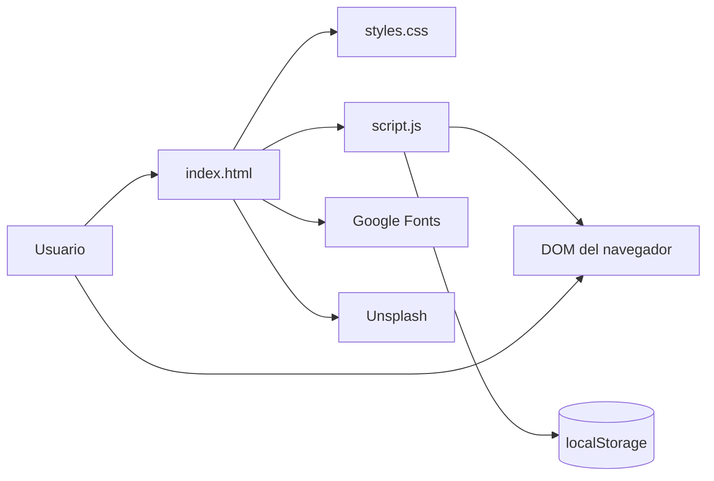
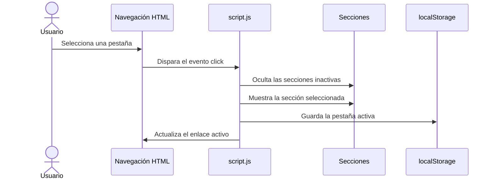
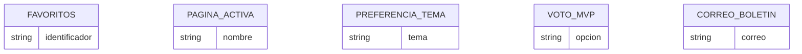

# GOALSTUDIO


Sitio web estático y responsivo dedicado al fútbol. Presenta noticias, partidos, clubes, futbolistas y estadísticas en una experiencia de navegación por pestañas sin necesidad de backend.

GOALSTUDIO está orientado a usuarios finales interesados en consultar contenido futbolístico, explorar perfiles y guardar preferencias desde el navegador.

## Acerca de la creación del proyecto

GOALSTUDIO fue diseñado e implementado con asistencia de inteligencia artificial, bajo la dirección, supervisión, revisión y criterio técnico de **Camilo Prieto**. La IA apoyó tareas de generación de estructura, desarrollo de estilos, interacción con JavaScript, corrección de problemas y elaboración de esta documentación.

El proyecto debe considerarse un prototipo de carácter demostrativo creado para aprender y explorar el desarrollo web. El contenido deportivo, las fechas, los resultados, las estadísticas y los marcadores incluidos pueden no representar datos oficiales ni encontrarse sincronizados con una fuente externa.

> Antes de utilizar este proyecto con fines públicos o comerciales, el contenido y el diseño deben revisarse manualmente para comprobar su precisión, accesibilidad, derechos de imagen y funcionamiento.

## Tabla de contenidos

- [Características principales](#características-principales)
- [Arquitectura](#arquitectura)
- [Stack tecnológico](#stack-tecnológico)
- [Estructura del proyecto](#estructura-del-proyecto)
- [Requisitos previos](#requisitos-previos)
- [Instalación y configuración](#instalación-y-configuración)
- [Uso](#uso)
- [Persistencia local](#persistencia-local)
- [Datos y fuentes](#datos-y-fuentes)
- [Flujo de desarrollo asistido por IA](#flujo-de-desarrollo-asistido-por-ia)
- [Calidad y accesibilidad](#calidad-y-accesibilidad)
- [Pruebas](#pruebas)
- [Despliegue](#despliegue)
- [Contribución](#contribución)
- [Licencia](#licencia)
- [Autores y contacto](#autores-y-contacto)
- [Información pendiente](#información-pendiente)

## Características principales

- Navegación por pestañas sin recarga de página.
- Inicio con carrusel de noticias destacadas.
- Buscadores de noticias, clubes y futbolistas.
- Filtros de partidos por competición.
- Cuenta regresiva de próximos partidos.
- Marcadores simulados de partidos en vivo.
- Favoritos persistidos en el navegador.
- Tema claro y tema oscuro.
- Comparador de estadísticas de futbolistas.
- Clasificación, resultados y encuesta MVP.
- Boletín con validación de correo en el navegador.
- Diseño adaptable a escritorio y dispositivos móviles.

## Arquitectura

### Visión general y principios de diseño

El proyecto usa una arquitectura de página estática. La estructura se encuentra en `index.html`, la presentación en `styles.css` y el comportamiento en `script.js`. No existe servidor de aplicación ni API propia.

Los principios principales son:

- Separación entre estructura, estilos y comportamiento.
- Navegación basada en secciones del DOM.
- Datos demostrativos escritos directamente en HTML y JavaScript.
- Persistencia opcional mediante `localStorage`.
- Ejecución sin dependencias de gestor de paquetes.

### Diagrama de arquitectura



### Flujo principal de navegación



### Responsabilidades

| Módulo | Responsabilidad |
|---|---|
| `index.html` | Contiene la estructura, las secciones, el contenido demostrativo y los enlaces a recursos externos. |
| `styles.css` | Define la identidad visual, componentes, temas y adaptación responsive. |
| `script.js` | Gestiona navegación, filtros, búsquedas, favoritos, carrusel, preferencias, contadores, encuesta y comparador. |
| `localStorage` | Conserva la pestaña, el tema, favoritos, voto y correo introducido en el boletín. |

### Modelo de datos

El proyecto no incluye una base de datos. Los datos mostrados son estáticos y las preferencias persistidas tienen una estructura simple:



### Decisiones técnicas

- **JavaScript Vanilla:** permite ejecutar el prototipo sin proceso de compilación ni dependencias de JavaScript.
- **Contenido en HTML:** simplifica el prototipo y mantiene visibles los datos principales sin una API.
- **CSS independiente:** permite modificar la presentación sin alterar el comportamiento.
- **`localStorage`:** proporciona persistencia básica sin requerir servidor ni base de datos.

### Consideraciones

- Las fotografías se obtienen desde Unsplash y las tipografías desde Google Fonts; el contenido visual requiere acceso a Internet.
- Los marcadores, partidos, noticias y estadísticas son datos demostrativos incluidos en el frontend.
- El correo del boletín se guarda localmente, pero el proyecto no envía mensajes ni se conecta con un proveedor de correo.
- La aplicación puede escalar mejor separando los datos estáticos en archivos JSON y conectándolos con una API real.

## Stack tecnológico

| Tecnología | Versión | Rol |
|---|---|---|
| HTML5 | Declarado por `<!DOCTYPE html>` | Estructura de la interfaz |
| CSS3 | Nativo del navegador | Diseño, responsive y temas |
| JavaScript | ECMAScript compatible con navegadores modernos | Interactividad y persistencia |
| Google Fonts | Servicio externo | Tipografías DM Sans y Oswald |
| Unsplash | Servicio externo | Imágenes de contenido |
| `localStorage` | API del navegador | Preferencias locales |

## Estructura del proyecto

```text
Proyecto con claude/
├── index.html     # Documento principal y contenido de las secciones
├── styles.css     # Diseño visual, temas y reglas responsive
├── script.js      # Navegación, búsquedas, filtros y persistencia
└── README.md      # Documentación del proyecto
```

## Requisitos previos

- Navegador moderno con soporte para JavaScript y `localStorage`.
- Conexión a Internet para cargar Google Fonts e imágenes de Unsplash.
- Un servidor HTTP local opcional.
- Python 3 opcional para servir los archivos desde una terminal.

## Instalación y configuración

### Ejecutar directamente

1. Descarga o clona el proyecto.
2. Abre `index.html` desde el explorador de archivos.

Algunas funciones de navegador pueden tener comportamientos distintos al abrir el archivo mediante `file://`; se recomienda usar un servidor local.

### Ejecutar con servidor HTTP local

Desde la carpeta del proyecto:

```bash
python -m http.server 8080
```

Después, abre:

```text
http://localhost:8080
```

## Uso

### Navegación

El menú permite acceder a:

- Inicio
- Noticias
- Partidos
- Clubes
- Futbolistas
- Estadísticas

### Buscadores

Escribe en los campos de búsqueda de Noticias, Clubes o Futbolistas. Los elementos se filtran por coincidencias con el texto visible.

### Filtros de partidos

Selecciona una competición en la pestaña Partidos para ocultar los partidos que pertenecen a otras competiciones.

### Tema

Pulsa el botón de luna o sol en la cabecera para cambiar entre tema oscuro y claro. La preferencia se conserva en el navegador.

## Persistencia local

El proyecto utiliza las siguientes claves de `localStorage`:

| Clave | Contenido |
|---|---|
| `goalstudio-page` | Pestaña activa seleccionada |
| `goalstudio-theme` | Tema claro u oscuro |
| `goalstudio-favorites` | Lista de elementos favoritos |
| `goalstudio-email` | Correo introducido en el boletín |
| `goalstudio-poll` | Opción seleccionada en la encuesta MVP |

## Datos y fuentes

La aplicación actual funciona sin una base de datos ni una API de datos deportivos. El contenido se conserva en los archivos HTML y JavaScript y puede clasificarse en los siguientes grupos:

| Tipo de dato | Ubicación | Naturaleza |
|---|---|---|
| Noticias y titulares | `index.html` | Contenido estático demostrativo |
| Clubes y futbolistas | `index.html` | Catálogo estático |
| Estadísticas del comparador | `script.js` | Datos locales de ejemplo |
| Fechas de partidos | Atributo `data-match` en `index.html` | Fechas demostrativas |
| Marcadores y movimientos | `script.js` | Simulación aleatoria |
| Preferencias del usuario | `localStorage` del navegador | Persistencia local |
| Fotografías | URLs externas de Unsplash | Recursos externos |
| Tipografías | Google Fonts | Recursos externos |

### Limitaciones conocidas

- No existe sincronización con ligas, clubes, plataformas deportivas ni servicios oficiales.
- Las estadísticas pueden quedar desactualizadas.
- El recuento de votos es local y no se comparte entre usuarios.
- El formulario del boletín no realiza una suscripción real.
- Los marcadores simulados pueden cambiar sin correspondencia con partidos reales.

## Flujo de desarrollo asistido por IA

El desarrollo siguió un proceso iterativo de colaboración entre persona y IA:

1. **Diseño de requisitos:** definición visual y funcional realizada por el usuario.
2. **Generación inicial:** creación de la estructura HTML, estilos y comportamiento.
3. **Iteración:** solicitud de mejoras visuales, nuevas secciones, páginas y funciones.
4. **Corrección:** resolución de errores de codificación, navegación, imágenes y responsividad.
5. **Validación humana:** revisión del proyecto por parte de Camilo Prieto.
6. **Documentación:** descripción técnica y técnica del estado real de la aplicación.

Las decisiones finales, la aprobación del diseño, la revisión del contenido y el uso del proyecto corresponden al autor humano.

## Calidad y accesibilidad

Los siguientes aspectos deben verificarse antes de una publicación definitiva:

- Contraste de texto en ambos temas.
- Navegación mediante teclado.
- Etiquetas y descripciones de elementos interactivos.
- Estado de enfoque visible.
- Uso de atributos ARIA cuando resulte necesario.
- Adaptación de imágenes, menús y formularios.
- Texto alternativo para contenido visual relevante.
- Compatibilidad con navegadores de escritorio y móviles.
- Validación HTML, CSS y JavaScript.

## Pruebas

El repositorio no contiene actualmente archivos de pruebas ni un flujo automatizado.

La sintaxis de JavaScript puede comprobarse con Node.js si está instalado:

```bash
node --check script.js
```

## Despliegue

Al ser una aplicación estática, puede desplegarse en cualquier servidor de archivos o servicio de páginas estáticas que publique `index.html`, `styles.css` y `script.js`.

## Contribución

Antes de enviar cambios:

1. Mantén la separación entre `index.html`, `styles.css` y `script.js`.
2. Verifica que las pestañas y botones no dejen errores en la consola.
3. Comprueba la interfaz en escritorio y móvil.
4. Ejecuta la comprobación de sintaxis de JavaScript.

No se encontraron convenciones oficiales de ramas, commits o versiones en el repositorio.

### Revisión de cambios asistidos por IA

Todo código generado o modificado con asistencia de IA debe pasar por una revisión humana antes de integrarse. La revisión debería incluir:

- Comprobación de requisitos.
- Verificación del comportamiento real en el navegador.
- Eliminación de contenido inventado o datos no comprobados.
- Prueba de navegación, formularios, temas y responsive.
- Ejecución de `node --check script.js`.
- Revisión de licencias de imágenes, tipografías y otros recursos externos.

## Licencia

<!-- TODO: agregar el tipo de licencia y el archivo LICENSE correspondiente -->

## Autores y contacto

Diseñado por **Camilo Prieto**.

El proyecto fue creado con asistencia de inteligencia artificial. La autoría humana corresponde a la dirección, selección, revisión y aprobación de los contenidos y cambios realizados.

<!-- TODO: agregar correo, perfil profesional o canal de contacto -->

## Información pendiente

- Nombre oficial definitivo del repositorio.
- Número de versión.
- Archivo de licencia.
- Badges de build e integración continua.
- Scripts o gestor de paquetes.
- Pruebas automatizadas.
- Proveedor real para el boletín de correo.
- API para reemplazar los datos estáticos.
- Dirección de despliegue o URL pública.
- Convenios oficiales de ramas y commits.
- Canal de contacto del autor.
# Pagina-web-GOALSTUDIO

